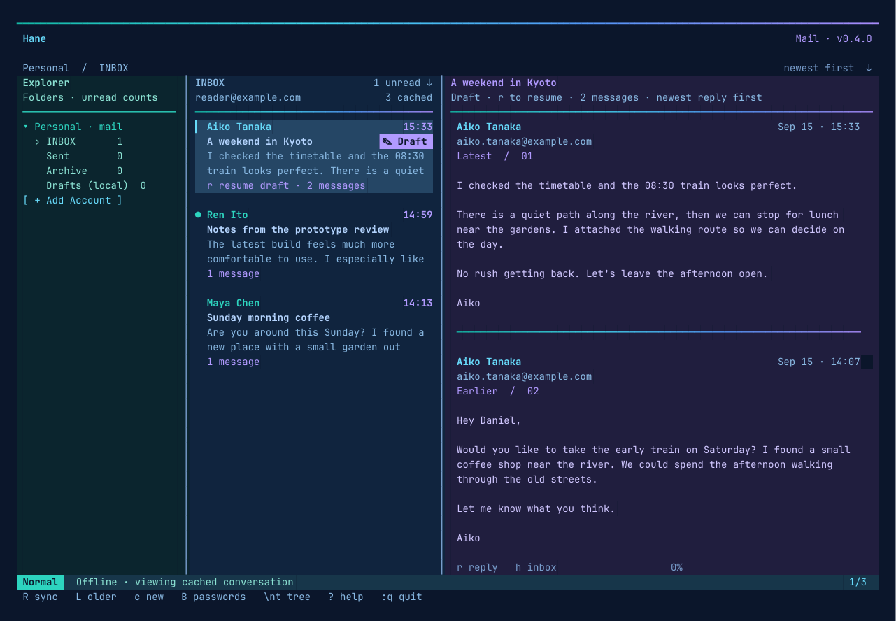
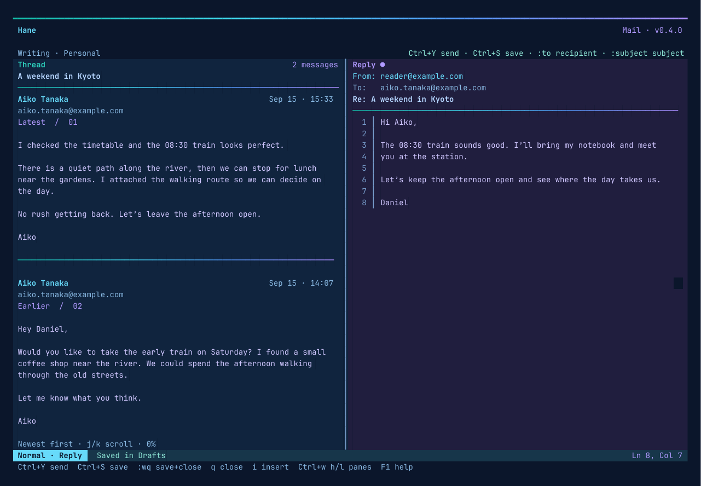

# Usage guide

[Install and quick start](../README.md)

## Reading and synchronization

- Use **j/k** to select a conversation and **l / Enter** to open it. **h / Esc** returns to the inbox.
- Conversations and the replies within them are newest first. Scroll the full conversation with **j/k**, **gg/G**, or **Ctrl+d/u**.
- The initial page contains the folder's **50 newest messages**. **L / :older** loads another 100. Previously downloaded pages stay cached across restarts. **/** searches downloaded sender, subject, and body text.
- **R / F5 / :sync** refreshes immediately. Background refresh runs every **60 seconds**, loading new messages in each account's active/default inbox, refreshing all folder counts and cached read/star flags. Selecting another folder loads it on demand.
- Opening a conversation searches all server folders for its Message-ID, References, and In-Reply-To relationships, including older parents beyond the inbox page. Copies with the same Message-ID display once in the conversation. Unrelated messages are not merged merely because they share a subject.
- Opening a thread marks its messages read. **u** toggles read/unread; **s** toggles starred. Changes are saved locally before being queued for the server. Temporary disconnections retain the queue. UIDVALIDITY checks prevent writes from targeting a different message after the server rebuilds a mailbox.
- Explorer and inbox unread counts come from server message counts, so they cover older, unloaded pages too. Pending local changes update those counts immediately.
- Mail is fetched with **BODY.PEEK**. Background downloads and previews do not mark messages read. HTML is converted to readable terminal text; scripts, styles, remote images, and tracking pixels are not loaded. Attachments are listed by name.

### Delete mail

Press **dd**, **Delete**, or **`:delete`** on a conversation in the inbox or reader. The confirmation starts on **Cancel**. Use **h/l**, **j/k**, or **Tab** to select **Move to Trash**, then Enter; Esc cancels.

The popup shows the number of **cached messages from the current folder** that will move. Messages from other folders and your saved replies remain intact. Load older mail with **L** or open the thread first if you need to include more of the conversation. The exact message IDs are captured when the popup opens, so a new arrival cannot become the deletion target.

Confirmed mail disappears immediately, and unread counts update with it. Pending deletions stay hidden across restarts and failed syncs. The original cached messages are retained until synchronization completes.

Each account has a **Sync queue [count]** entry in the explorer. **Q / :queue** opens it directly. Use **j/k** and **Enter** to inspect a move, its status, and any error. **R** retries synchronization. The queue distinguishes waiting offline, syncing, retry needed, and needs review; completed entries disappear automatically. Queue counts represent pending moves, not unread mail. Open the account's Trash folder to find moved mail. Hane does not offer permanent deletion or emptying Trash.

In **Drafts (local)**, the same keys offer **Delete draft** instead. This removes the saved draft from this device after confirmation; drafts with pending or uncertain delivery must be resolved first.

Servers with native MOVE use it. iCloud uses staged UIDPLUS operations: copy to Trash, persist the server's copy receipt, verify the Trash copies, then remove only the original UIDs. No mailbox-wide EXPUNGE is used. If the app loses the COPY response or stops before saving its receipt, it retains the originals and blocks automatic copying. Check Trash, then **`:canceldelete`** on the affected entry in **Sync queue** clears that uncertain attempt and makes the originals visible again. A subsequent **dd** starts a fresh confirmation and may create another Trash copy.

### Explorer

**\\nt** or **Space n t** toggles the explorer; **\\nf** reveals the current folder. Account rows collapse with **h** and expand with **l**; Enter or a click toggles them. **+ Add Account** stays at the bottom. **A / :addaccount** also opens account setup; **e** on an account edits its settings.

## Drafting and sending

### Reply

Press **r** on a conversation. A previously saved reply resumes automatically, and inbox tiles show a violet **✎ Draft** badge. The reply uses the sender's Reply-To address when present and includes References / In-Reply-To headers for threading.

The conversation stays on the **left**, with the reply editor on the **right**. Press **Ctrl+w**, release it, then **h** or **l** to switch panes. Below 96 columns, only the focused pane is shown.

### New message

Press **c / :new** on a configured account. New messages use the full editor width.

1. In Normal mode, type **`:to friend@example.com`**, then Enter. Multiple recipients can be comma-separated.
2. Type **`:subject Your subject`**, then Enter.
3. Press **i** to write the body.

`:to` and `:subject` also edit the headers of a reply or saved draft. Sending requires valid recipients, a subject, and a non-empty body. Recipient or subject line breaks are rejected.

### Save and close

The editor starts in **Normal** mode with a block cursor. **i** enters **Insert** with a bar cursor. **Esc** returns to Normal; **q / Esc** in Normal closes the editor. **Ctrl+q** closes it from either mode. **F1** shows its keymap.

Real-account drafts **autosave 750 ms after editing stops**. **Ctrl+s / :w** saves immediately; **:wq** saves and closes. Drafts survive restarts in **Drafts (local)**, independently of the provider's server Drafts folder. They are stored on this device, not uploaded to iCloud or Gmail.

If unsaved changes remain when closing, the popup offers Keep editing, Save & close, or Discard changes. A failed disk write keeps the editor open. `:q!` discards changes made since the latest manual save or autosave; it does not delete an already saved draft.

### Send

**Ctrl+y / :send** submits the current message through the account's SMTP server. This is real delivery for configured accounts. The editor shows Sending and freezes edits until the result arrives. Saving, closing, autosaving, launching, and syncing never trigger SMTP delivery.

Before submission, the app saves the draft and a durable delivery record. After the SMTP server confirms acceptance, the draft is removed and the reply appears in its conversation and Sent. A separate IMAP operation saves the Sent copy, checking Message-ID first to avoid duplicate copies. If filing fails, **R** retries only the Sent copy, not delivery.

If SMTP rejects the message, the draft remains available. If the connection drops while acceptance is uncertain—or the app stops during submission—the draft is marked **delivery uncertain**. Normal Send will not silently retry it. **Check Sent and the recipient's delivery status first.** `:retry-send` is an explicit retry that may deliver a duplicate; the app first checks Sent for the original Message-ID. An edited uncertain message must be restored to its original recipients, subject, and body before that retry.

SMTP acceptance confirms submission to the server, not final delivery to the recipient. Provider bounces can still arrive afterward.

## Keymap

| Keys | Action |
|---|---|
| `h j k l`, arrows | Navigate or scroll |
| `Enter` / click | Open folder, thread, or saved draft |
| `\nt` / `Space n t`; `\nf` | Toggle explorer; reveal current folder |
| `gg/G`, `Ctrl+d/u` | First/last, half-page movement |
| `R` / `F5` / `:sync` | Refresh mail, flags, counts, and pending Sent copies |
| `L` / `:older` | Fetch 100 older messages in the folder |
| `/` | Search downloaded mail; Esc clears |
| `u`; `s` | Toggle unread; toggle starred |
| `dd` / Delete / `:delete` | Confirm move to Trash, or delete a saved local draft |
| `Q` / `:queue` | Open pending Trash moves and their status |
| `r`; `c` / `:new` | Reply/resume draft; new message |
| `i`; `Esc` | Insert mode; Normal mode |
| `Ctrl+w`, then `h/l` | Focus thread/reply |
| `:to addresses`; `:subject text` | Edit recipients; edit subject |
| `Ctrl+s` / `:w`; `:wq` | Save; save and close |
| `Ctrl+y` / `:send` | Send current message |
| `F1` in editor | Editor keymap |
| `A` / `:addaccount`; `e` on account | Add account; edit/sign in |
| `B` / `:passwords` | Set up or refresh Bitwarden-backed credentials |
| `q` / `:q` / `Ctrl+c` | Close thread first; from inbox, confirm quitting |

The quit popup starts on **Cancel**. Use h/l, Tab, or arrows, then Enter; Esc cancels. Within the editor, close commands use the draft save/discard flow instead of quitting the app.

## Accounts and passwords

Account setup starts in Normal mode: **j/k** moves fields, **gg/G** goes first/last, **h/l** changes selectors, and **i / Enter** edits a text field. In Insert, j/k type normally. Esc returns to Normal; q/Esc in Normal cancels. Errors retain the form for retry. IMAP uses verified TLS; SMTP uses verified STARTTLS or TLS.

- **iCloud / @me.com:** use an app-specific password. Defaults follow [Apple's server settings](https://support.apple.com/en-us/102525).
- **Gmail:** app passwords are supported for eligible accounts with 2-Step Verification. OAuth-only accounts are not supported yet; see [Google's app-password requirements](https://support.google.com/accounts/answer/185833?hl=en).
- **Custom:** IMAP over implicit TLS and SMTP password authentication with PLAIN inside TLS are supported.

After connecting, **B** or `./hane --password-setup` opens the Bitwarden wizard. It uses a dedicated app-password login item whose username is your full email address. It can create that item or import a specific existing item ID. It does not search or export the rest of your vault.

The three password prompts serve different purposes:

| Prompt | Password |
|---|---|
| Bitwarden master password | Unlocks your Bitwarden vault |
| Mail app password | The generated iCloud/Gmail app password |
| Sorakyaku keyring password | Protects the local credential collection |

The system keyring stores a local copy of the mail password. Bitwarden does not need to remain unlocked for normal use. On this Linux machine, the separate **Sorakyaku** GNOME Keyring collection may need one unlock after desktop login. Empty-password GNOME keyrings are rejected. The Bitwarden and keyring passwords are independent, even if you choose the same text for both.

After changing the app password in Bitwarden, press **B** again to refresh the local copy. This is an explicit copy, not automatic cloud synchronization between password managers. The Bitwarden CLI has separate encrypted state in `~/.config/sorakyaku/bitwarden-cli/`; its unlock session stays in process memory. Hane does not store your Bitwarden master password.

## Storage

Hane keeps the original `sorakyaku` storage directories, credential service, and **Sorakyaku** keyring collection so existing accounts, cached mail, drafts, pending operations, and saved passwords continue to work without migration. Existing Bitwarden item IDs remain valid.

| Location | Contents |
|---|---|
| `~/.config/sorakyaku/accounts.json` | Server settings, remember-password preference, Bitwarden item IDs |
| `~/.local/share/sorakyaku/mail.json` | Cached mail, local drafts, pending flag changes and Trash moves, delivery records |
| GNOME Keyring / native credential store | Mail app passwords |

`XDG_CONFIG_HOME` and `XDG_DATA_HOME` override these defaults. Account and mail files use atomic replacement and owner-only `0600` permissions; new directories use `0700`. The mail cache contains readable message text and is **not separately encrypted**. Passwords are excluded from the mail cache and account settings.

Corrupt or unsupported mail storage is preserved and blocks startup instead of being overwritten. A process lock prevents two app instances from writing the same store or sending the same draft concurrently. Credential and cache identity includes the account's server endpoints and login names; changing destinations creates a separate identity.

## Current limits

- Plain-text replies and new messages; no attachment downloads/uploads, HTML composition, Bcc, OAuth, permanent deletion, or general folder moves yet.
- Drafts are local to this device. The server Drafts folder can be read, but server draft editing/upload is not implemented.
- Search covers downloaded mail. Load older pages with L to expand it.
- Message text downloads are limited to 1 MiB of encoded input shared across up to 16 text parts, and 2 MiB of decoded text. The reader labels truncated text. Very large or deeply malformed conversations stop at 500 referenced IDs / 12 lookup rounds with an incomplete-thread notice.
- Polling runs once a minute; IMAP IDLE push is not implemented. Cached folders refresh flags/removals; newly arriving mail in other folders is downloaded when those folders are selected.
- Linux is the tested platform. macOS binaries compile for Apple Silicon and Intel and use macOS Keychain, but runtime behavior still needs validation on a Mac. Windows has not been validated.
- `--demo` retains the original session-only drafts and simulated sends. It never transmits mail.
